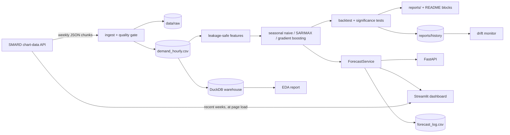
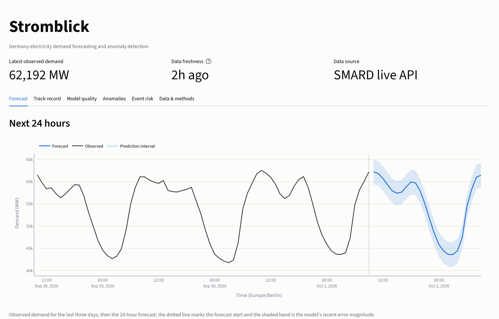
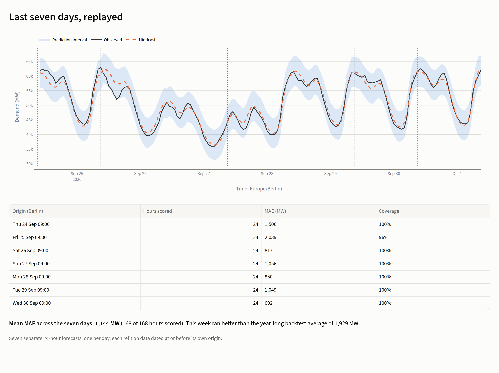
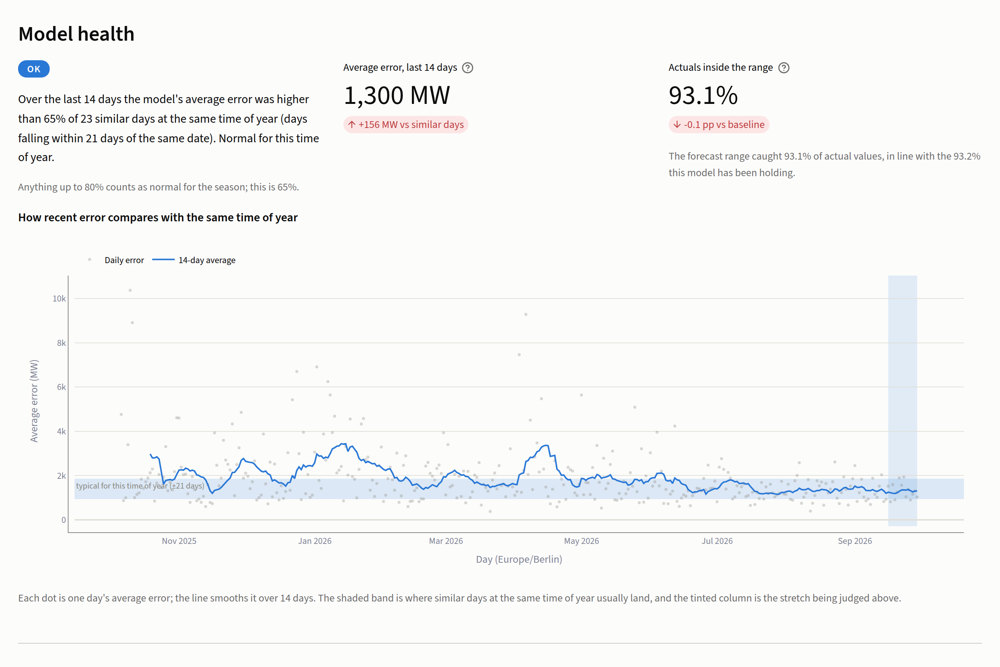

# Stromblick: next-day electricity demand for Germany

[](https://github.com/jyotishmanh07/stromblick/actions/workflows/ci.yml)

Live dashboard: [stromblick.streamlit.app](https://stromblick.streamlit.app/)

# Introduction & Goals

Stromblick forecasts German electricity demand for the next 24 hours and flags hours where demand was unusually high or low. Germany's grid is getting harder to plan for. More of the supply depends on the weather, and heat pumps and electric cars keep changing the shape of demand. A bad forecast costs real money: balancing parties pay for every MW they miss, and grid operators hold reserve capacity sized to the expected error.

- **Data:** hourly total grid load for Germany from SMARD, the Bundesnetzagentur's public electricity market platform. Three years of history, refreshed every week; the forecaster trains on the latest two.
- **Tools:** Python (pandas, scikit-learn, statsmodels), DuckDB for the SQL reporting layer, FastAPI, Streamlit, Docker, and GitHub Actions for the scheduled jobs.
- **What I do with it:** ingest and validate the data, build features that can't leak the future, compare three forecasting models with a walk-forward backtest, publish one forecast a day to a log in git, and watch the model for drift.
- **Result:** the gradient-boosted model roughly halves the error of the "same hour yesterday" baseline, and that gap is statistically significant. Against the grid operators' own day-ahead forecast it's a statistical tie with the data I can actually get, but averaging the two beats the operators on their own. Public holidays are its weakest spot. Current numbers are under [Results](#results).

For a non-technical summary of the business case, see the [write-up](reports/writeup.md). For the whole analysis in one place (data, baselines, error by horizon, what the model relies on, the prediction band and the studies), see the [notebook](notebooks/analysis.ipynb). It only reads committed results, so it runs in seconds.

**Goal 1:** beat the simplest sensible forecast, "same hour yesterday", by enough to justify a real model.
**How I know it worked:** the champion's MAE is about half the seasonal-naive MAE over 300+ daily forecast origins, and a paired bootstrap on per-origin errors puts the difference well clear of zero.

**Goal 2:** publish a forecast every day and keep the record, so I can check later whether what I said was right.
**How I know it worked:** a daily workflow has committed one 24-hour forecast per day to [`data/forecasts/forecast_log.csv`](data/forecasts/forecast_log.csv) since September 2026, and it refuses to log if the data it would forecast from is stale.

**Goal 3:** notice when the model gets worse without raising false alarms every winter.
**How I know it worked:** on the August 2026 snapshot, 2.2% of no-drift windows crossed the warning threshold. Requiring two bad weekly runs in a row before calling it a regression brings false alarms under 1%.

## Architecture



# Contents

- [The Data Set](#the-data-set)
  - [How much data is it](#how-much-data-is-it)
- [Constraints](#constraints)
- [Used Tools](#used-tools)
  - [Connect](#connect)
  - [Buffer](#buffer)
  - [Processing](#processing)
  - [Storage](#storage)
  - [Visualization](#visualization)
- [Pipelines](#pipelines)
  - [Batch Processing](#batch-processing)
  - [Stream Processing](#stream-processing)
  - [Visualizations](#visualizations)
- [Results](#results)
  - [Against the operators' forecast](#against-the-operators-forecast)
- [Demo](#demo)
- [What Breaks](#what-breaks)
- [Conclusion](#conclusion)
- [Running it yourself](#running-it-yourself)
- [Follow Me On](#follow-me-on)
- [Appendix](#appendix)

# The Data Set

The source is SMARD module 410, actual total grid load for Germany, read through SMARD's chart-data API. There's an index file at `https://www.smard.de/app/chart_data/410/DE/index_hour.json` listing weekly chunks, and each chunk (`.../410_DE_hour_<epoch_ms>.json`) holds hourly average demand in MW keyed by epoch milliseconds. I convert that to one UTC row per hour with two columns, `timestamp` and `demand_mw`.

I picked it because it's official, free, updated continuously, and the problem is real: grid operators forecast exactly this number every day. It also has a few properties that make it more interesting than a clean Kaggle file:

- SMARD publishes actual load late. A lag of several hours up to about a day is normal, so "now" and "the last hour I have data for" are different things, and the forecast starts from the latter.
- Recent hours can appear in the index before they have values. Those show up as gaps.
- SMARD can revise past values, so any published number should cite the snapshot it came from. Provenance (source URLs, collection time, row count, date range) goes into `data/clean/metadata.json`.
- Timestamps cross two DST changes a year. Everything is stored in UTC and only converted to Europe/Berlin for calendar features and display.

Gaps are reported, never filled in. Data is attributed to **Bundesnetzagentur | SMARD.de** under **CC BY 4.0**.

If the clean CSV is missing, the API and dashboard fall back to a synthetic demo series so the code still runs. That's for smoke tests only, not for analysis.

## How much data is it

Not much, which is fine for this problem:

- 1 value per hour × 24 hours × 7 days = 168 rows per weekly chunk
- 157 weekly chunks × 168 rows ≈ 26,400 rows for three years
- That's about 900 KB as CSV, and about 2 MB of raw JSON from SMARD
- SMARD's full archive goes back to 2015: about 104,000 hours, which the [training-window study](reports/window_study.md) uses

The daily forecast log adds 24 rows a day, under 9,000 rows a year. Everything fits in memory many times over, so a pandas-and-DuckDB stack is plenty and anything distributed would be overkill.

The size that actually matters is the backtest: a year of daily origins, each refitting three models, takes about 45 minutes. SARIMAX is most of that, which is why it trains on one year while the main model trains on two. That's what sets how often the full benchmark can run.

# Constraints

- **Budget:** zero. Everything runs on GitHub Actions' free tier, Streamlit Community Cloud, and my laptop.
- **Compute:** a laptop and free CI runners. The full backtest is about 45 minutes, so it runs weekly in CI, not on every push.
- **Data I don't control:** SMARD decides when hours get published, can revise history, and could change its API. The dashboard has to survive all three.
- **Time:** one person, evenings. That's a big part of why there's no orchestrator or feature store.
- **Hosting:** Streamlit Cloud's filesystem doesn't persist between restarts, so the dashboard can't save anything it fetches. It fetches into memory and caches for an hour.
- **History:** SMARD goes back to 2015, but German demand dropped by about 8% around the 2022 energy crisis and stayed there, so older years describe a grid that no longer exists. How much of that history to train on is a measured choice, not a default (see [Processing](#processing)).

# Used Tools

## Connect

[smard_api.py](src/energy_forecast/smard_api.py) reads the SMARD index and pulls the last N weekly chunks (`--weeks 157`, three years, by default). Every raw response is written to `data/raw/` first, so if a batch is rejected later I still have the evidence.

All sources go through one function, `canonicalize_demand()` in [data.py](src/energy_forecast/data.py). It matches column names loosely, treats timezone-less timestamps as Europe/Berlin and converts them to UTC, drops duplicates (keeping the last), and resamples to hourly.

Then the quality gate in [quality.py](src/energy_forecast/quality.py) runs before anything is written to `data/clean/`. Checks come in two levels. Errors stop the ingest: bad schema, duplicate or unsorted timestamps, timestamps not in UTC, values outside 20 to 100 GW, or (optionally) a stale snapshot. Warnings get recorded but don't stop anything: the fraction of missing hours and the fraction of unpublished hours, since gaps are normal for SMARD. The full report lands in `metadata.json` and shows up in the dashboard.

I wrote the checks by hand instead of using Great Expectations. With one table and about ten checks, the framework would be more code to maintain than the checks themselves. At a bigger scale I'd switch.

## Buffer

There isn't one. Data arrives once a week in a batch, and the dashboard pulls what it needs at page load. A queue like Kafka would have nothing to smooth out.

## Processing

**Features** ([features.py](src/energy_forecast/features.py)): hour, weekday, month, German public holidays, DST-change flags, lagged demand (1h, 24h, 168h), and trailing means (24h, 7d). Every lag and rolling window is shifted by one hour before it's computed, so no row can see its own value or anything after it. There are two builders, one vectorized for training and one row-at-a-time for forecasting, and they share one column list so they can't drift apart.

**Models** ([models.py](src/energy_forecast/models.py)), three of them:

1. Seasonal naive: same hour yesterday, falling back to same hour last week.
2. SARIMAX: a classical statistical baseline with daily seasonality.
3. `HistGradientBoostingRegressor`: the main model. It forecasts recursively, feeding each hour's prediction back in as a lag for the next.

**Training window** ([scripts/window_study.py](scripts/window_study.py), [report](reports/window_study.md)): the model used to train on whatever the 52-week snapshot held. I tested 1, 2, 3 and 5 years and everything since 2015, on 731 daily origins over two years, with the adoption rule written down before the run: a longer window wins only if its paired bootstrap CI against one year is entirely below zero and it survives a Holm correction. In the November 2026 study, two years won: 110 MW lower MAE than one year, CI [−158, −65]. The more interesting part is where the gain comes from. It's concentrated in winter, the season one year of history has seen only once: about 415 MW in winter 2024/25. Outside winter the gain is much smaller, and training on everything since 2015 is worse than one year. The gain was also much smaller in the most recent year than in the year before, so I'd treat it as real but modest. Two explanations I expected turned out wrong: older, higher-demand years don't pull forecasts up (every window under-forecasts slightly), and one-year models don't fail by having to predict outside the range they trained on.

**Evaluation** ([evaluation.py](src/energy_forecast/evaluation.py)): a rolling-origin backtest. Pick an origin, train on everything before it, forecast the next 24 hours, score it, move forward a day, repeat. No random splits anywhere. Metrics are MAE, RMSE and sMAPE, plus error broken down by hour, weekday, month and holiday.

**Significance** ([inference.py](src/energy_forecast/inference.py)): a Wilcoxon test and a paired bootstrap on per-origin errors, and Diebold-Mariano on hourly errors. I use per-origin values as the sampling unit because the 24 hours in one forecast share the same weather and demand level, so treating them as independent would overstate confidence.

**Prediction band** ([calibration.py](src/energy_forecast/calibration.py), [study](reports/interval_study.md)): split conformal. The band is the forecast plus or minus the conformal 95% quantile of how wrong the model's last 28 daily forecasts were. I got here by testing the old band against five alternatives on a year of daily origins, with the rule fixed before the run. The study found a bug in how I'd been measuring it: the band the dashboard showed was sized from one week-long forecast, so it mixed in large week-ahead errors and was too *wide* (96.8% coverage), while the benchmark had been scoring a different, narrower recipe and reporting that it was too narrow. In the November 2026 study, split conformal caught 94.4% of actuals with a band 27% narrower than the old one. Conformalized quantile regression scored slightly better, but I couldn't separate the two on average and it needs two extra models in the serving path, so I shipped the simpler one. Computing the band needs 28 model fits, too slow for API startup, so the daily workflow builds that calibration file and commits it. If it's missing or more than a week old, the app falls back to the old band and labels it as the fallback.

**Anomalies:** observed hours outside the 1st to 99th percentile of errors on the week before the window. These are empirical bounds, not calibrated probabilities.

**Tuning** ([scripts/tune.py](scripts/tune.py)): a nested search with Optuna. The inner loop tunes on origins in the first 70% of the data, and the outer loop checks the winner on later origins it never saw. On the last search ([reports/tuning.md](reports/tuning.md)) the inner gain was 3.5% but the outer gain was 1.3%, with a confidence interval that includes zero, so I kept the defaults. A new config only replaces them if the outer interval is entirely below zero.

**Daily event classifier** ([events.py](src/energy_forecast/events.py)): a side track asking a yes/no question per day. Will tomorrow be a high-demand day? Will it contain an anomalous hour? Labels use trailing-window thresholds computed only from earlier days.

**Drift** ([drift.py](src/energy_forecast/drift.py)): each full benchmark run saves its per-origin errors to `reports/history/`. The most recent 14 origins are ranked against origins from the same time of year in earlier runs. It has to be the same time of year because error is strongly seasonal on its own. On the August 2026 snapshot, January MAE was 2.1 times August MAE with no drift involved, so comparing against a yearly average would flag every winter. I use a rank instead of a z-score because the error distribution has a long right tail. The result is `ok`, `watch`, `regressed` or `unknown`. It shows up in the dashboard and never fails a workflow.

## Storage

- **Files in git:** the clean demand CSV, its `metadata.json`, and the forecast log. They're committed on purpose: the hosted dashboard needs real data, and a forecast log is only worth something if nobody can quietly edit it. Raw SMARD payloads stay out of git and can be rebuilt by re-running the ingest.
- **DuckDB** ([warehouse.py](src/energy_forecast/warehouse.py), [sql/](sql/)): a reporting warehouse with `fact_demand`, `dim_calendar` and `fact_forecast`. The calendar table is built from the same holiday and DST helpers the model uses, so SQL and features can't disagree on what counts as a holiday. [tests/test_warehouse.py](tests/test_warehouse.py) checks every query against a pandas equivalent. The `.duckdb` file is gitignored and rebuilt when needed.

I chose DuckDB over Postgres because it's a single file with no server, and over a cloud warehouse because the data is tiny and the budget is zero. Ingestion doesn't go through the warehouse. `canonicalize_demand()` stays the only path in.

There are no model files. Every forecast refits from scratch (about half a second), so nothing is ever pickled and a stale model file can't exist.

## Visualization

- **Streamlit dashboard** ([app/streamlit_app.py](app/streamlit_app.py)), hosted on Streamlit Community Cloud. Tab by tab walkthrough in [reports/dashboard_guide.md](reports/dashboard_guide.md).
- **FastAPI** ([api.py](src/energy_forecast/api.py)): `GET /health` and `POST /forecast`. The request needs a timezone-aware `as_of` and a horizon of 1 to 24 hours. Responses are UTC timestamps with a prediction and band per hour.
- **Markdown reports** under [reports/](reports/), regenerated by the scripts: EDA, benchmark, classification and tuning.

# Pipelines

## Batch Processing

Everything is batch. There are three GitHub Actions workflows:

- **Weekly refresh** ([refresh-data.yml](.github/workflows/refresh-data.yml), Mondays 05:17 UTC): ingest the last three years, run the quality gate, rebuild the warehouse and EDA, run the full backtest and the classification benchmark, run the tests, and commit the new snapshot, reports and README. If the gate fails, nothing is committed.
- **Daily forecast log** ([log-forecast.yml](.github/workflows/log-forecast.yml), 06:23 UTC): fetch the latest data, issue one 24-hour forecast, and append it to `forecast_log.csv`. If the live fetch fails, it fails loudly and logs nothing, because a forecast made from stale data isn't a record of what would have been published. Running it twice changes nothing.
- **CI** ([ci.yml](.github/workflows/ci.yml)): lint and tests on every push.

The two committing workflows share a concurrency group, so they never push at the same time, and they write to different files.

I used cron workflows instead of Airflow or Dagster. One weekly job and one daily job with no fan-out don't need a scheduler, a metadata database and a server to look after. If this grew to many sources, that's where I'd add one.

The benchmark scripts rewrite the marked blocks in this README, so the numbers under [Results](#results) always match the latest run. A capped test run can't write to the drift history, and neither can an uncapped run with under 200 origins, since that usually means a broken ingest.

## Stream Processing

None. SMARD publishes with a lag of hours, so there's no real-time feed to stream. The closest thing is the dashboard's live fetch:

- At page load it pulls recent weekly chunks and merges them onto the committed snapshot ([live.py](src/energy_forecast/live.py)), cached for an hour.
- The number of weeks fetched depends on how old the snapshot is (between 2 and 8). A fixed two-week fetch against a two-month-old snapshot would leave a hole in the series and break the lag features.
- Live values overwrite committed ones, but an hour that's indexed and not yet published can never overwrite a real value.
- Any failure (API down, bad payload, failed quality check) falls back to the committed snapshot with a warning in the app.

The API doesn't do any of this. It loads its data when it starts, and a network call there would slow startup and make the tests depend on the network.

## Visualizations

There are three published forecast views, and they answer different questions:

- **Backtest:** how good is the model in general? (`reports/benchmark.md`)
- **Replay:** what would the model have said on each of the last seven days? Each day is refit only on data available at that time, but it's computed now. (dashboard, Track record tab)
- **Forecast log:** what did the model actually say, at the time? (`data/forecasts/forecast_log.csv`) Only this one can't be reconstructed after the fact.

# Results

Full report: [reports/benchmark.md](reports/benchmark.md). The tables below are regenerated by `scripts/benchmark.py` every week.

<!-- RESULTS-TABLE:START — generated by scripts/benchmark.py; do not edit by hand -->
366 daily origins over the latest year (HistGradientBoosting on the trailing 2 years, SARIMAX on the trailing 1 year), each scored on the next 24 hours (8,784 forecast hours, Nov 2025 – Nov 2026):

| Model | MAE (MW) | RMSE (MW) | sMAPE (%) | MAE vs seasonal-naive |
|---|---|---|---|---|
| Seasonal naive | 3,893 (±2,286) | 4,915 | 7.44 | — |
| SARIMAX | 3,704 (±2,345) | 4,642 | 7.25 | -4.8% |
| HistGradientBoosting | 1,505 (±838) | 1,826 | 2.86 | -61.3% |

Paired bootstrap over the 366 origins puts the champion's MAE advantage at [1,959, 2,444] MW against its closest rival (Wilcoxon p = 1.4e-42). Full significance section in [reports/benchmark.md](reports/benchmark.md).
<!-- RESULTS-TABLE:END -->

<!-- FINDINGS:START (generated by scripts/benchmark.py; do not edit by hand) -->
**Is the win real?** Tested, not asserted: `HistGradientBoosting` has 2,387 MW lower MAE than Seasonal naive (95% CI [2,142, 2,632], Wilcoxon p = 9.8e-42, Diebold-Mariano p = 5.0e-47); 2,199 MW lower MAE than SARIMAX (95% CI [1,959, 2,444], Wilcoxon p = 1.4e-42, Diebold-Mariano p = 1.1e-52). Per-origin MAE is the sampling unit, because hours inside one 24-hour window share weather and demand level; Diebold-Mariano runs on hourly losses with a correction for that dependence instead.

**Does the interval hold?** 94.3% of actuals land inside the 95% band (95% CI [93.1%, 95.5%], p = 0.259), consistent with the target.

**Weak spot: public holidays.** Holiday hours cost 972 MW more absolute error than ordinary hours (95% CI [627, 1,344], permutation p = 2.0e-04, Cohen's d = 0.67). The worst hour of the day is 10:00 Berlin time.

**What it relies on.** Permutation importance on a held-out week: shuffling `lag_1h` raises MAE by 8,807 MW, far ahead of `hour` (1,814 MW), `weekday` (150 MW).
<!-- FINDINGS:END -->

The numbers from the original August 2026 snapshot are kept at the [`benchmark-2026-08`](https://github.com/jyotishmanh07/stromblick/tree/benchmark-2026-08) tag.

Daily event classifier, full report in [reports/classification.md](reports/classification.md):

<!-- CLASSIFICATION:START (generated by scripts/benchmark_classification.py; do not edit by hand) -->
| Target | Champion | PR-AUC | Lift over base rate | ROC-AUC |
|---|---|---|---|---|
| High-demand day (peak in the trailing month's top 30%) | HistGradientBoosting | 0.743 | 2.34× | 0.884 |
| Anomaly day (an hour departing from seasonal-naive) | HistGradientBoosting | 0.712 | 6.15× | 0.931 |

On the **anomaly** target the gradient-boosted model beats the calendar-only baseline (PR-AUC 0.712 vs 0.609), so those days carry demand signal beyond holidays and DST on this snapshot. On the August 2026 snapshot the two nearly tied, which is why this reading is recomputed rather than written down.
<!-- CLASSIFICATION:END -->

## Against the operators' forecast

Beating "same hour yesterday" is the minimum. The harder question is how the model compares with the day-ahead load forecast Germany's transmission operators publish, which SMARD carries as module 411 ([study](reports/tso_study.md), [script](scripts/tso_study.py)). The tricky part is giving both sides the same information. The operators issue their forecast for day D at about 10:00 the day before, with weather forecasts and real-time metering. I only see actual load once SMARD publishes it, about a day late, and I use no weather. So I scored the model three ways on 365 days, with the rule for what counts as a win written down first:

| My model's information | vs operators, per day (Nov 2026 study) | Verdict |
|---|---|---|
| Data right up to midnight before D (impossible in practice) | −511 MW, CI [−642, −379] | beats them |
| Data up to their issue time, about 38 hours ahead | −170 MW, CI [−315, −23] | beats them |
| What I can actually get: their issue time minus SMARD's lag, about 62 hours ahead | +150 MW, CI [−15, +323] | can't tell apart |
| Fixed 50/50 average of theirs and that lagged forecast | −177 MW, CI [−265, −88] | beats them |

So the honest claim is a tie, not a win. The gap between the second and third rows says that data latency costs more than model quality does: with real-time actuals the model would beat the official forecast. The most useful result is the last row. Averaging the two forecasts, with weights fixed in advance rather than fitted, is about 9% more accurate than the operators alone, because the two make different mistakes. The breakdown shows where each is stronger: the lagged model is slightly better outside winter, and the operators win clearly in winter and on public holidays, which is where weather forecasts and regional holiday knowledge pay off.

## Does weather help?

The operators win in winter, and they use weather forecasts, so temperature was the obvious feature to add. It is also the easiest one to leak: train and score on *observed* temperature and the model gets to see the weather it is meant to be forecasting. So every version trains and predicts on one source, and only forecasts that existed in time count ([study](reports/weather_study.md), [script](scripts/weather_study.py)). Temperature is a population-weighted average over the ten largest cities, from Open-Meteo's archive of past GFS forecasts and from ERA5 for the observed version. The rule was written down first: weather ships only if the 48-hours-ahead forecast beats no weather.

| Temperature source | vs no weather, per origin (Nov 2026 study) | Verdict |
|---|---|---|
| Forecast made 48 hours ahead (what I could really use) | −19 MW, CI [−58, +21] | can't tell apart |
| Forecast made 24 hours ahead | −38 MW, CI [−77, +1] | can't tell apart |
| Observed (impossible in practice) | −21 MW, CI [−67, +30] | can't tell apart |

So I didn't ship it. The interesting row is the last one: even perfect weather doesn't clearly help, so a better weather forecast wouldn't change the answer. At a 24-hour horizon, yesterday's load at the same hour was drawn under nearly the same weather, and the lag features already carry most of what temperature would say. That also suggests where the operators' winter edge comes from: they forecast about 62 hours ahead of my last data point, where the lags are older and weather should matter more. That is the next thing to test.

## What the model relies on

The benchmark's permutation importance scores one-step-ahead rows, where every lag is a real measurement. The shipped forecast is recursive: from the second hour on, `lag_1h` is the model's own previous prediction. So I computed exact SHAP values on the rows the model actually forecast from, at every benchmark origin ([report](reports/explainability.md), [script](scripts/explain.py)). In the November 2026 run, `lag_1h` carried most of the attribution (87%) at both one hour and 24 hours ahead, while the error grew from about 0.6 GW to 2.2 GW. The model keeps leaning on its own output, so an early miss is carried through the day. That is also why one band width for all 24 hours under-covers the last ones. On public holidays the holiday flag pulls the forecast down, but closes only about a third of the gap.

# Demo

The live version is at [stromblick.streamlit.app](https://stromblick.streamlit.app/). It pulls the latest SMARD data when it loads, so it forecasts from the most recent published hour, not from whenever the snapshot was committed.



The Forecast tab shows the last three days of observed demand and the next 24 hours. The shaded band is where 95% of actuals should land, sized from how wrong the last 28 daily forecasts were.



The Track record tab replays the last seven daily forecasts against what actually happened, with MAE and band coverage per day.



The Model health panel shows the drift verdict, recent per-origin error against the same time of year, and band coverage compared with its usual level.

The other tabs cover the full backtest, an anomaly explorer, tomorrow's high-demand-day probability next to the recent base rate, and the data provenance and quality report. [reports/dashboard_guide.md](reports/dashboard_guide.md) goes through every chart.

# What Breaks

- **What breaks first: the band at long horizons.** The band has one width for every hour ahead, but error grows with the horizon, so it over-covers the next few hours and under-covers the last few (about 89% at 19 to 24 hours ahead in the interval study). It also assumes the coming day looks like the last month, which holidays break: even with two years of training data the model has seen each one only twice. A band that widens with the horizon is the next thing I'd try.
- **What I tested and left out: temperature.** Adding it, from forecasts that existed at the time, didn't clear the bar at a 24-hour horizon, and neither did observed temperature (see [Does weather help?](#does-weather-help)). Solar radiation is untested: rooftop solar lowers measured grid load, but the forecast archive only has it from 2024, too short for a two-year training window plus a year of scoring.
- **Risk I accepted: a short track record per model.** The drift monitor only compares a model generation with itself, so when the training window changed, its history restarted. Each backtest covers a full year, so every season has a reference from the first run on, but only one earlier year of it until more runs accumulate. The classifier has about a thousand labelled days, which is enough to rank models but not to settle close calls.
- **What I'd change for production:** test weather at longer horizons and add solar once the archive is long enough, save the exact data each forecast was made from, keep a final untouched test period, and move the weekly job into a real orchestrator once there's more than one source.

People: the data is national grid load added up across all of Germany. There's nothing about individuals in it, and the anomaly flags describe hours, not anyone's behaviour.

# Conclusion

The gradient-boosted model clearly beats both baselines, and the significance tests back that up instead of just pointing at a lower average. The parts that took the most work weren't the model:

- **Defining the labels for the classifier was the hardest part.** My first attempt, "top 10% of all days so far", just learned "is it winter". A trailing 60-day top 10% still left whole test months with no positive days. The trailing 30-day top 30% was the third attempt. [reports/classification.md](reports/classification.md) documents the two that failed.
- **Nested tuning was worth it.** The inner search showed a gain, but most of it disappeared on unseen origins. Without the outer loop I'd have shipped a config that only looked better.
- **More data helped, but not evenly.** Two years of training beat one, mostly in winter, and most of it in the earlier of the two test years. A single pooled number would have hidden that, and the breakdown is what stopped me from picking five years just because it had the lowest average.
- **Seasonality breaks naive monitoring.** A drift check that compares against the overall average would go red every January. Comparing to the same time of year was what made it usable.
- **Who you compare against, and with what information, decides the headline.** Against the grid operators the model "wins" or "ties" depending only on how fresh its data is assumed to be. Pinning down the information cutoffs before scoring turned a tempting claim into an honest one, and the blend made the result useful anyway.
- **A null result needs an oracle next to it.** Temperature not helping could mean bad weather forecasts or a feature with nothing to add. Scoring observed weather alongside told the two apart: even the oracle didn't help, so the answer is the second.
- **A backtest isn't a track record.** Being able to replay old forecasts didn't prove what the model said at the time. That's why the forecast log is committed to git every day.

# Running it yourself

```bash
python -m venv .venv
source .venv/bin/activate
pip install -e ".[dev]"
pytest -q
uvicorn energy_forecast.api:app --reload    # API on :8000
streamlit run app/streamlit_app.py           # dashboard on :8501
```

Or both services with Docker:

```bash
docker compose up --build
```

## Explore the notebook

[notebooks/analysis.ipynb](notebooks/analysis.ipynb) is the best place to poke at the results yourself. GitHub shows it with its outputs, but it's more fun to open it and change things:

```bash
pip install -e ".[notebook]"
jupyter lab notebooks/analysis.ipynb
```

It trains nothing, so every cell runs in seconds, and every table is a plain pandas DataFrame read from a committed CSV. Some things to try:

- Slice the backtest your own way. `reports/benchmark_champion_hourly.csv` has every forecast hour of the latest year (origin, timestamp, actual, predicted), so you can group the error by month, weekday or hour, or pull out a single bad day.
- Compare the models on the days you care about. `reports/benchmark_metrics.csv` has one row per origin and model.
- Rerun a forecast from any past hour. The package is importable from the notebook, and one fit takes about two seconds:

```python
from energy_forecast.models import HistGradientBoostingForecast

demand = pd.read_csv("data/clean/demand_hourly.csv", parse_dates=["timestamp"])
origin = pd.Timestamp("2025-12-23 09:00", tz="UTC")       # any hour in the snapshot
model = HistGradientBoostingForecast().fit(demand[demand.timestamp <= origin])
hours = pd.date_range(origin + pd.Timedelta(hours=1), periods=24, freq="1h")
forecast = pd.Series(model.predict(hours), index=hours)
actual = demand.set_index("timestamp").demand_mw.reindex(hours)
(forecast - actual).abs().mean()                            # MAE in MW for that day
```

The run-up to Christmas is a good place to start. The forecast above misses by about 3.2 GW, roughly twice a typical day, and moving the origin a few days either way shows how fast that changes.

Refresh the data and rebuild the reports:

```bash
PYTHONPATH=src python scripts/ingest_smard_api.py --weeks 157
PYTHONPATH=src python scripts/generate_eda.py        # reports/eda.md + figures
PYTHONPATH=src python scripts/benchmark.py           # reports/benchmark.md, ~45 min
PYTHONPATH=src python scripts/window_study.py        # reports/window_study.md, ~1 h (--report-only rebuilds from cache)
PYTHONPATH=src python scripts/weather_study.py       # reports/weather_study.md, ~20 min (--report-only rebuilds from cache)
PYTHONPATH=src python scripts/explain.py             # reports/explainability.md (SHAP), ~6 min
jupyter nbconvert --to notebook --execute --inplace notebooks/analysis.ipynb   # needs pip install -e ".[notebook]"
```

Call the API:

```bash
curl http://localhost:8000/health
curl -X POST http://localhost:8000/forecast \
  -H 'content-type: application/json' \
  -d '{"as_of":"2026-08-28T00:00:00Z","horizon_hours":24}'
```

# Follow Me On

GitHub: [jyotishmanh07](https://github.com/jyotishmanh07)

# Appendix

README structure based on the template from Andreas Kretz's [Data Engineering Cookbook](https://github.com/andkret/Cookbook).
