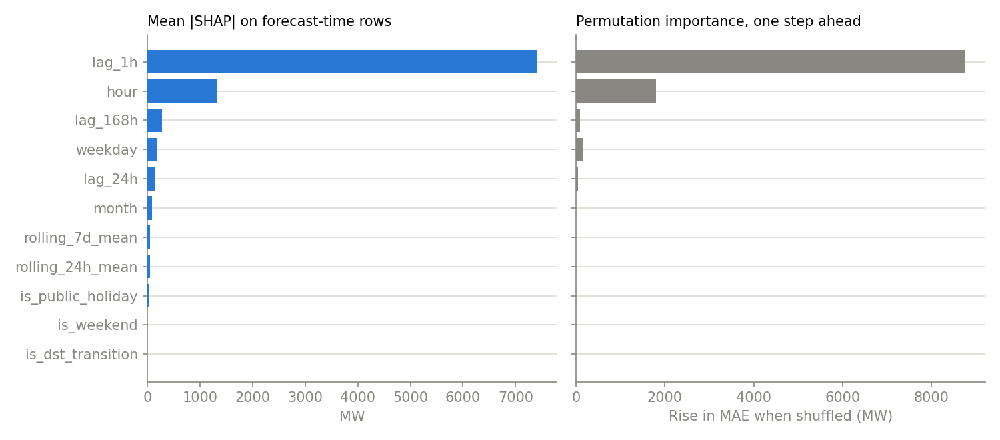
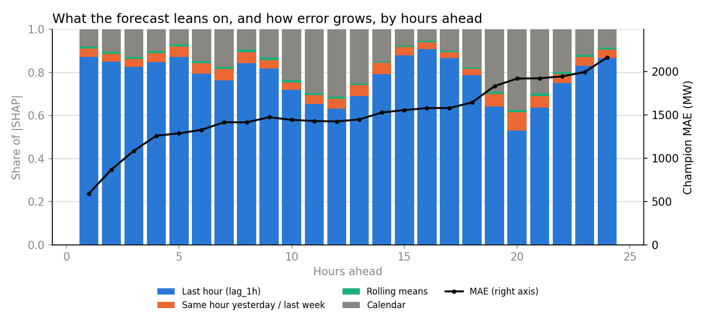
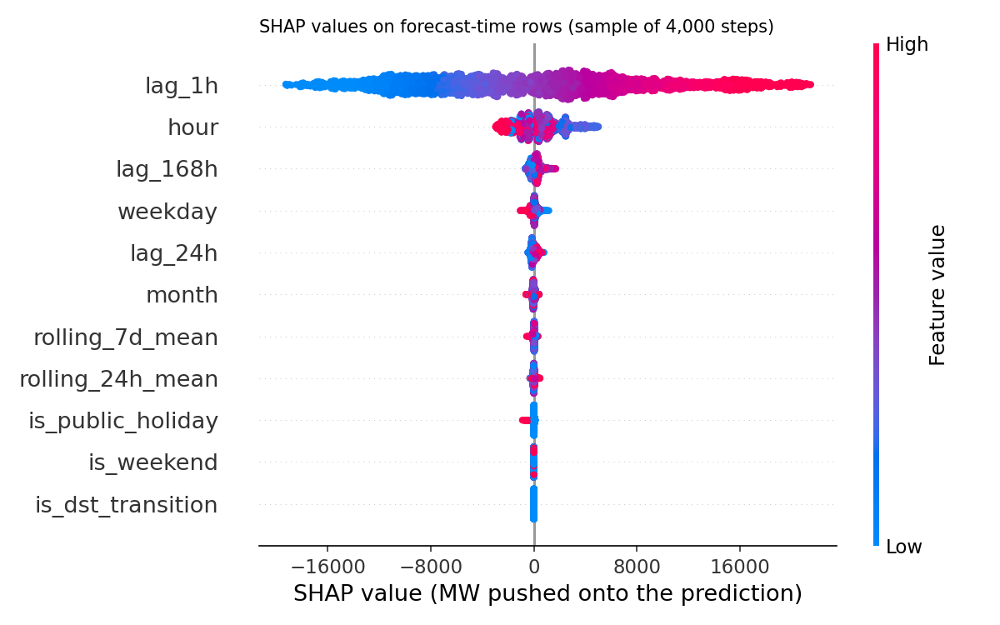

# What the forecast relies on

Generated 2026-11-24 by `scripts/explain.py` (Python 3.10.16, scikit-learn 1.7.2, model v2).

The benchmark's permutation importance shuffles features on rows whose lags are observed, i.e. one step ahead. The served forecast is recursive: from the second hour on, `lag_1h` is the model's own previous prediction. This report explains the rows the model really predicted from, at 366 daily origins from 2025-11-22 to 2026-11-22 (the benchmark's origins), with exact TreeSHAP values. They add up to each prediction (largest gap 2.9e-10 MW).

## Importance, two ways

| Feature | Mean \|SHAP\| at forecast time (MW) | Permutation, one step ahead (MW) |
|---|---|---|
| `lag_1h` | 7,407 | 8,775 |
| `hour` | 1,329 | 1,801 |
| `lag_168h` | 274 | 92 |
| `weekday` | 181 | 144 |
| `lag_24h` | 149 | 33 |
| `month` | 82 | 0 |
| `rolling_7d_mean` | 48 | 0 |
| `rolling_24h_mean` | 40 | -12 |
| `is_public_holiday` | 24 | 0 |
| `is_weekend` | 0 | 0 |
| `is_dst_transition` | 0 | 0 |

The two methods answer different questions. SHAP says how far each feature moves a prediction away from the average one; permutation says how much accuracy is lost without it, on one held-out week. The difference that matters is what `lag_1h` *is*: in the permutation test it is a measured value; at forecast time it is a measurement only at step 1 and the model's own output afterwards.

## By hours ahead

Share of total |SHAP| per feature group at each step, with the champion's MAE by step from the committed benchmark:

| Hours ahead | Last hour (lag_1h) | Same hour yesterday / last week | Rolling means | Calendar | MAE (MW) |
|---|---|---|---|---|---|
| 1 | 87% | 4% | 1% | 8% | 591 |
| 6 | 79% | 5% | 1% | 15% | 1,328 |
| 12 | 63% | 5% | 1% | 31% | 1,424 |
| 18 | 79% | 3% | 1% | 18% | 1,644 |
| 24 | 87% | 4% | 1% | 9% | 2,165 |

At one hour ahead `lag_1h` carries 87% of the attribution; at 24 hours it carries 87%, and the calendar features go from 8% to 9%. So the model leans on its own previous output almost as hard at the end of the day as at the start. An early miss is carried forward, which is consistent with MAE rising from 591 MW one hour ahead to 2,165 MW at 24 hours, and with the prediction band under-covering the last hours of the day (see `interval_study.md`).

One caveat: every benchmark origin is at 09:00 UTC, so hours ahead and time of day move together here. The calendar share peaking mid-horizon is most likely the evening and night hours, where the hour-of-day shape matters most, rather than a horizon effect.

## Direction of each effect

Each dot is one forecast step; colour is the feature's value, position its push on the prediction.

## Public holidays

Over 216 forecast hours that fall on a public holiday, `is_public_holiday` moves the prediction by -352 MW on average, while the forecast still ends up +801 MW off (forecast minus actual; -97 MW on other hours).

The holiday flag pushes in the right direction but closes only about 31% of the gap it would otherwise leave. With two years of training data each holiday has been seen at most twice.

## Files

- `explainability_summary.json`: every number in this report.
