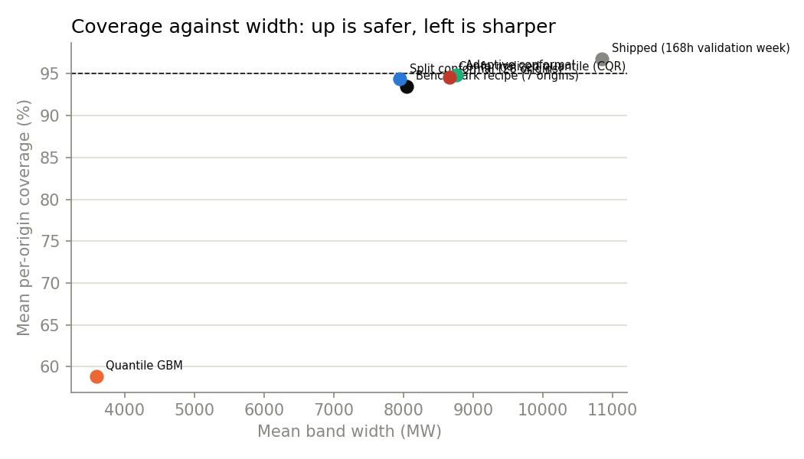
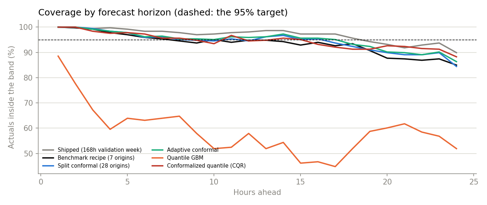

# Prediction-band study

Generated 2026-11-24 by `scripts/interval_study.py` (model v2, Python 3.10.16, scikit-learn 1.7.2).

Question: the forecast's 95% band is built from recent errors. Does 95% of demand actually land inside it, and is there a band that does while staying narrow?

## Two recipes that were treated as one

The dashboard and API size the band from one 168-hour recursive forecast over the week before the origin, so its error pool mixes horizons from 1 to 168 hours. The weekly benchmark has been reporting coverage for a different recipe: the 24-hour errors of the previous 7 origins. On the same origins here, the shipped band covers 96.8% and the benchmark's recipe 93.5%.

## Design

- 366 daily origins from 2025-11-22 to 2026-11-22, after 28 warm-up origins used only as calibration history. Point forecasts come from the shipped model.
- Calibration pools end with the previous origin, whose 24 hours are all observed by the current one, so no band sees the hours it scores.
- Adaptive conformal uses gamma = 0.02, alpha clipped to (0.001, 0.5). Quantile GBM uses the champion's parameters with `loss="quantile"` at 2.5% and 97.5%.
- The rule, set before the run: switch only if the coverage CI contains 95% and the paired interval-score CI against the shipped band is entirely below zero with Holm p < 0.05 across the five candidates.

## Result

| Method | Coverage | 95% CI | Mean width (MW) | Interval score | vs shipped | 95% CI | Holm p | Calibrated | Sharper | Meets the rule |
|---|---|---|---|---|---|---|---|---|---|---|
| Shipped (168h validation week) | 96.8% | [95.9, 97.6] | 10,847 | 12,809 |  |  |  | no |  | (baseline) |
| Benchmark recipe (7 origins) | 93.5% | [92.2, 94.7] | 8,043 | 11,662 | -1,147 | [-1,861, -411] | 1.3e-12 | no | yes | no |
| Split conformal (28 origins) | 94.4% | [93.1, 95.5] | 7,947 | 11,439 | -1,370 | [-2,122, -587] | 6.7e-13 | yes | yes | yes |
| Adaptive conformal | 94.9% | [93.7, 95.9] | 8,757 | 11,721 | -1,088 | [-1,753, -386] | 1.8e-09 | yes | yes | yes |
| Quantile GBM | 58.9% | [56.7, 61.0] | 3,595 | 24,367 | +11,559 | [+9,601, +13,572] | 2.6e-28 | no | no | no |
| Conformalized quantile (CQR) | 94.6% | [93.5, 95.7] | 8,656 | 11,207 | -1,602 | [-2,331, -898] | 9.3e-07 | yes | yes | yes |

**Verdict: switch to Conformalized quantile (CQR).** Its coverage is 94.6% (CI [93.5, 95.7] contains 95%) and its interval score is 1,602 lower than the shipped band's (CI [-2,331, -898], Holm p = 9.3e-07).

## By horizon

A pooled band has one width for every hour ahead, but error grows with the horizon, so a pooled band tends to be too wide early and too narrow late.

Coverage:

| Method | 1-6h | 7-12h | 13-18h | 19-24h |
|---|---|---|---|---|
| Shipped (168h validation week) | 99.4% | 97.7% | 97.4% | 92.6% |
| Benchmark recipe (7 origins) | 98.3% | 94.6% | 93.7% | 87.5% |
| Split conformal (28 origins) | 98.6% | 95.1% | 94.9% | 88.9% |
| Adaptive conformal | 98.6% | 95.7% | 95.5% | 89.7% |
| Quantile GBM | 70.0% | 58.2% | 49.3% | 58.0% |
| Conformalized quantile (CQR) | 98.5% | 95.1% | 93.7% | 91.2% |

Mean width (MW):

| Method | 1-6h | 7-12h | 13-18h | 19-24h |
|---|---|---|---|---|
| Shipped (168h validation week) | 10,847 | 10,847 | 10,847 | 10,847 |
| Benchmark recipe (7 origins) | 8,043 | 8,043 | 8,043 | 8,043 |
| Split conformal (28 origins) | 7,947 | 7,947 | 7,947 | 7,947 |
| Adaptive conformal | 8,757 | 8,757 | 8,757 | 8,757 |
| Quantile GBM | 3,794 | 3,407 | 2,644 | 4,536 |
| Conformalized quantile (CQR) | 8,854 | 8,468 | 7,704 | 9,596 |

## By season

Mean per-origin coverage. Descriptive only.

| Method | Rest of year | Winter |
|---|---|---|
| Shipped (168h validation week) | 97.1% | 95.9% |
| Benchmark recipe (7 origins) | 93.6% | 93.4% |
| Split conformal (28 origins) | 94.6% | 93.5% |
| Adaptive conformal | 94.8% | 95.1% |
| Quantile GBM | 60.0% | 55.3% |
| Conformalized quantile (CQR) | 94.7% | 94.4% |

## Reliability across levels

Mean per-origin coverage when each residual-pool method targets other levels. A calibrated method sits on the diagonal (50% at 50%, and so on). Adaptive conformal and the quantile methods were built for the 95% level only.

| Method | 50% band | 80% band | 90% band | 95% band |
|---|---|---|---|---|
| Shipped (168h validation week) | 66.4% | 89.5% | 94.3% | 96.8% |
| Benchmark recipe (7 origins) | 50.6% | 78.2% | 88.6% | 93.5% |
| Split conformal (28 origins) | 49.6% | 79.6% | 89.7% | 94.4% |

## Files

- `interval_study_origins.csv`: per-origin coverage, width and interval score per method.
- `interval_study_summary.json`: every number in this report.
