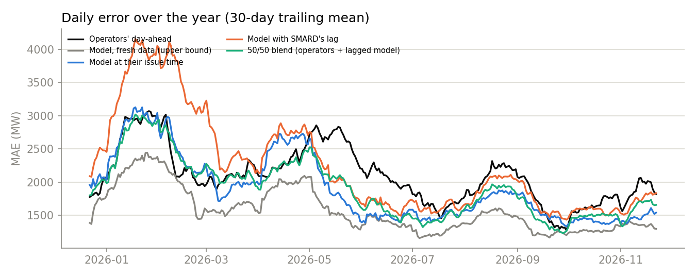
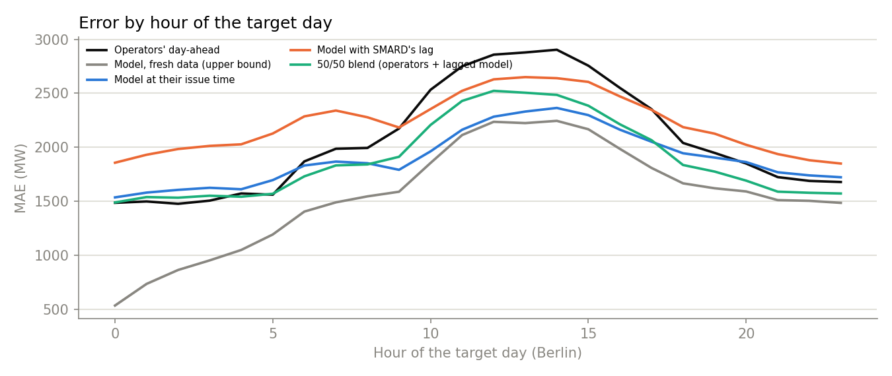

# Against the operators' day-ahead forecast

Generated 2026-11-24 by `scripts/tso_study.py` (model v2, Python 3.10.16, scikit-learn 1.7.2).

Question: how does the model compare with the forecast Germany's transmission operators publish for the next day?

## What module 411 is

SMARD's chart-data module 411 is not in the bundesAPI documentation, so it is identified from the data: it extends to the end of the next day while actual load (module 410) lags by about a day, and it tracks actual load hour by hour. That is the shape of a day-ahead load forecast. Its timestamps line up with module 410: shifting it by an hour either way raises its error by about a third. Its yearly error against actual load:

| Year | Mean bias (MW) | MAE (MW) |
|---|---|---|
| 2015 | -3,040 | 3,264 |
| 2016 | -3,486 | 3,540 |
| 2017 | -2,124 | 2,307 |
| 2018 | -1,656 | 1,980 |
| 2019 | -2,121 | 2,401 |
| 2020 | -1,167 | 1,821 |
| 2021 | -1,764 | 2,267 |
| 2022 | +772 | 2,196 |
| 2023 | +172 | 1,943 |
| 2024 | -401 | 1,963 |
| 2025 | +396 | 1,933 |
| 2026 | +248 | 2,080 |

Before 2022 it ran well below actual load every year. That looks like a change in how one of the two series is defined rather than a change in skill, so only the latest year is compared below, where the bias is small.

## Design

- 365 target days, 2025-11-23 to 2026-11-22, each scored on its own Berlin-time hours (23 or 25 on DST days), one MAE per day as the sampling unit.
- The operators' forecast is assumed to be issued at 10:00 Berlin on the day before. If SMARD shows a later revision instead, this comparison is generous to them.
- The model, the shipped v2 champion, is refit at each cut-off on data dated at or before it and forecasts recursively through the end of the target day:
  - **fresh data**: the last hour before the day (impossible in practice; upper bound)
  - **at their issue time**: 10:00 on the day before (about 38 hours ahead)
  - **with SMARD's lag**: 24 hours earlier still (about 62 hours ahead), which is what this project could actually issue at the operators' issue time
- The blend averages the operators' forecast and the lagged model with fixed equal weights.
- Rule set before the run: paired bootstrap CI and Holm-corrected Wilcoxon p for each comparison; "beats" or "worse" only when the CI excludes zero and Holm p < 0.05.

## Result

| Forecast | Mean daily MAE (MW) | Mean bias (MW) | vs operators (MW) | 95% CI | Holm p | Verdict |
|---|---|---|---|---|---|---|
| Operators' day-ahead | 2,069 | +215 | | | | (reference) |
| Model, fresh data (upper bound) | 1,558 | +281 | -511 | [-642, -379] | 2.2e-16 | beats the operators |
| Model at their issue time | 1,899 | +57 | -170 | [-315, -23] | 2.1e-04 | beats the operators |
| Model with SMARD's lag | 2,219 | +45 | +150 | [-15, +323] | 0.601 | indistinguishable from the operators |
| 50/50 blend (operators + lagged model) | 1,892 | +130 | -177 | [-265, -88] | 5.1e-07 | beats the operators |

**Headline, with SMARD's lag: indistinguishable from the operators** (+150 MW per day, 95% CI [-15, +323], Holm p = 0.601). That is the comparison this project could actually deliver at the moment the operators issue theirs.

The fixed 50/50 blend: **beats the operators** (-177 MW, CI [-265, -88]). A blend can beat both inputs when their errors are not perfectly correlated; the weights were fixed, not fitted.

## Where the difference comes from

Mean daily MAE (MW). Descriptive only; the paired test above is the decision.

| Season | Days | Operators' day-ahead | Model, fresh data (upper bound) | Model at their issue time | Model with SMARD's lag | 50/50 blend (operators + lagged model) |
|---|---|---|---|---|---|---|
| Rest of year | 275 | 1,985 | 1,445 | 1,730 | 1,900 | 1,733 |
| Winter | 90 | 2,324 | 1,903 | 2,416 | 3,195 | 2,378 |

| Day type | Days | Operators' day-ahead | Model, fresh data (upper bound) | Model at their issue time | Model with SMARD's lag | 50/50 blend (operators + lagged model) |
|---|---|---|---|---|---|---|
| Public holiday | 9 | 2,491 | 2,878 | 3,354 | 4,224 | 3,009 |
| Weekend | 104 | 2,013 | 1,543 | 1,835 | 2,221 | 1,857 |
| Working day | 252 | 2,077 | 1,517 | 1,874 | 2,147 | 1,867 |

## Files

- `tso_study_days.csv`: per-day MAE and bias per forecast.
- `tso_study_summary.json`: every number in this report.
