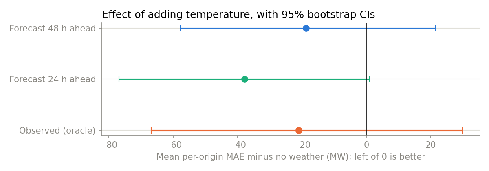
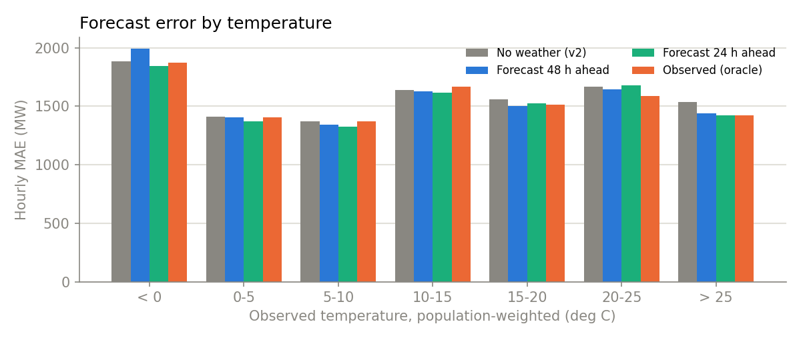

# Weather study

Generated 2026-11-24 by `scripts/weather_study.py` (Python 3.10.16, scikit-learn 1.7.2, model v2).

Question: does temperature make the 24-hour forecast better, if the model may only use weather forecasts that existed when its own forecast was issued?

## Design

- 366 daily origins from 2025-11-17 to 2026-11-17, each scored on the next 24 hours. Every arm trains on the same two years before the origin (the shipped v2 window).
- Temperature: population-weighted mean of Germany's ten largest cities. Two features, the hour's temperature and its trailing 24-hour mean.
- Each arm trains *and* predicts on one source. Forecasts are gfs_seamless from Open-Meteo's previous-runs archive; observed is ERA5 reanalysis.
  - **Forecast 48 h ahead**: published long before any origin that uses it. The realistic arm.
  - **Forecast 24 h ahead**: fresher; for the last hours of the horizon the run may have been published a few hours after the origin, so it can be slightly optimistic.
  - **Observed (oracle)**: not available at forecast time. An upper bound.
- Rule, set before the run: per-origin MAE, paired bootstrap 95% CI and Wilcoxon p against no weather, Holm-corrected over three. Weather ships only if the Forecast 48 h ahead arm's CI is entirely below zero and its Holm p < 0.05.

Over the scored period the temperature forecasts miss ERA5 by 1.14 deg C (48 h) and 1.08 deg C (24 h) on average.

## Result

| Arm | Mean MAE (MW) | vs no weather (MW) | 95% CI | Wilcoxon p | Holm p | Beats |
|---|---|---|---|---|---|---|
| No weather (v2) | 1,549 | | | | | |
| Forecast 48 h ahead | 1,531 | -19 | [-58, +21] | 0.035 | 0.070 | no |
| Forecast 24 h ahead | 1,512 | -38 | [-77, +1] | 0.015 | 0.044 | no |
| Observed (oracle) | 1,528 | -21 | [-67, +30] | 0.070 | 0.070 | no |

**Verdict: not shown to help.** The forecast 48 h ahead arm changes mean per-origin MAE by -19 MW (95% CI [-58, +21], Holm p = 0.070), which does not meet the rule set before the run.

Even observed weather does not meet the rule (-21 MW, 95% CI [-67, +30]), so the limit is not the accuracy of the weather forecast. The likely reason: at a 24-hour horizon the lag features already carry most of what temperature says, because yesterday's load at the same hour was drawn under nearly the same weather.

## By season

Same paired comparison within each season of the origin; * marks a CI that excludes zero. Not part of the decision rule.

| Subset | Origins | No weather MAE | Forecast 48 h ahead vs none | Forecast 24 h ahead vs none | Observed (oracle) vs none |
|---|---|---|---|---|---|
| Winter | 90 | 1,739 | +49 [-62, +166] | -44 [-157, +67] | +13 [-127, +173] |
| Spring | 92 | 1,654 | -7 [-75, +66] | -31 [-97, +41] | +32 [-47, +123] |
| Summer | 92 | 1,507 | -47 [-113, +22] | -23 [-94, +50] | -76 [-140, -12] * |
| Autumn | 92 | 1,302 | -69 [-126, -15] * | -53 [-101, -6] * | -52 [-118, +10] |

## By temperature

Hourly MAE (MW) by observed temperature band. Descriptive only.

| Band (deg C) | Hours | No weather (v2) | Forecast 48 h ahead | Forecast 24 h ahead | Observed (oracle) |
|---|---|---|---|---|---|
| < 0 | 829 | 1,887 | 1,990 | 1,842 | 1,873 |
| 0-5 | 1,678 | 1,414 | 1,405 | 1,370 | 1,405 |
| 5-10 | 1,781 | 1,374 | 1,344 | 1,325 | 1,370 |
| 10-15 | 1,591 | 1,639 | 1,626 | 1,615 | 1,668 |
| 15-20 | 1,551 | 1,563 | 1,503 | 1,528 | 1,515 |
| 20-25 | 879 | 1,668 | 1,645 | 1,682 | 1,590 |
| > 25 | 475 | 1,534 | 1,438 | 1,424 | 1,420 |

## Public holidays

Holiday-hour MAE over origins whose window contains a holiday hour. Indicative only.

| Arm | Mean MAE (MW) | vs no weather (MW) | 95% CI | Wilcoxon p | Holm p | Beats |
|---|---|---|---|---|---|---|
| No weather (v2) | 2,471 | | | | | |
| Forecast 48 h ahead | 2,531 | +59 | [-256, +417] | 0.747 | 1.000 | no |
| Forecast 24 h ahead | 2,561 | +90 | [-219, +437] | 0.963 | 1.000 | no |
| Observed (oracle) | 2,628 | +157 | [-329, +678] | 0.678 | 1.000 | no |

## Caveats

- One weather model (GFS) at ten points. A finer model (ICON) is only archived from 2024, too short for a two-year training window with a year of scoring behind it.
- Temperature only. Solar radiation matters too (rooftop solar lowers measured grid load), but the archive has it only from 2024 for the same reason.
- Shipping would serve fresher live forecasts than the 48 h ones the model trained on. That mismatch is in the safe direction but is a mismatch; it would need its own check once live forecasts are logged.

## Files

- `weather_study_origins.csv`: per-origin MAE and bias for every arm.
- `weather_study_summary.json`: every number in this report.
