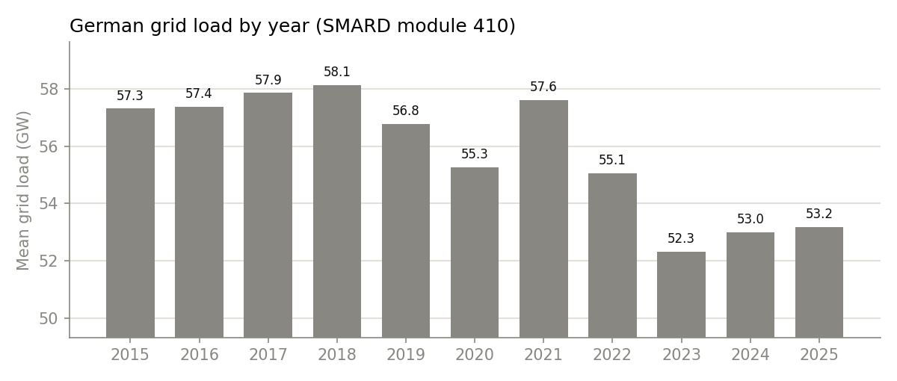
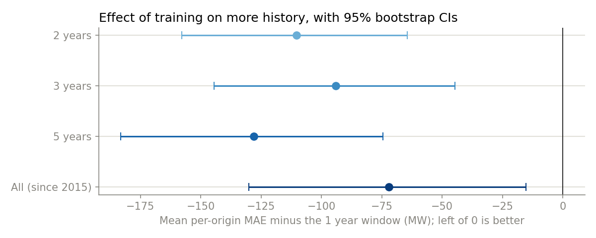
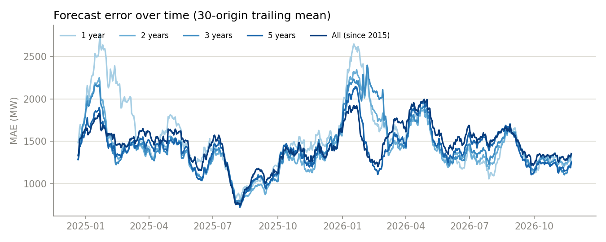

# Training-window study

Generated 2026-11-24 by `scripts/window_study.py` (Python 3.10.16, scikit-learn 1.7.2).

Question: does the gradient-boosting forecaster do better trained on one year of history, or on more? More history shows the model every season and holiday several times. It also spans the 2022-23 drop in German demand, so older rows describe a level the grid no longer runs at.

## The data

SMARD module 410, 104,267 hourly observations from 2014-12-31 to 2026-11-23, all passing the project's ingest quality gate.

Mean load peaked at 58.1 GW in 2018 and was lowest at 52.3 GW in 2023.

## Design

- 731 origins, one every 24 hours from 2024-11-22 to 2026-11-22, each scored on the next 24 hours.
- At each origin, one model per window: 1 year, 2 years, 3 years, 5 years, All (since 2015). Same model, same default parameters, same forecast hours. Only the start of the training slice moves.
- Per-origin MAE is the sampling unit, as in the main benchmark, because the 24 hours of one forecast share weather and demand level.
- The rule, set before the run: a window replaces the one-year baseline only if the paired bootstrap 95% CI on its MAE difference lies entirely below zero and its Wilcoxon p stays under 0.05 after a Holm correction for the four comparisons.

## Result

| Window | Mean per-origin MAE (MW) | vs 1 year (MW) | 95% CI | Wilcoxon p | Holm p | Clears the rule |
|---|---|---|---|---|---|---|
| 1 year (baseline) | 1,529 | | | | | |
| 2 years | 1,418 | -110 | [-158, -65] | 1.0e-04 | 4.1e-04 | yes |
| 3 years | 1,435 | -94 | [-145, -45] | 0.004 | 0.013 | yes |
| 5 years | 1,401 | -128 | [-183, -74] | 0.025 | 0.051 | no |
| All (since 2015) | 1,457 | -72 | [-130, -15] | 0.320 | 0.320 | no |

**Verdict: train on 2 years.** It lowers mean per-origin MAE by 110 MW against 1 year (95% CI [-158, -65], Holm p = 4.1e-04), the largest gain among the windows that met the rule set before the run.

## Stability

The decision uses the pooled test above. This table re-runs the same paired comparison on parts of the period, to check whether the gain holds throughout or rests on one part of it. Each cell is the mean per-origin MAE difference against 1 year in MW, with its 95% bootstrap CI; * marks a CI that excludes zero. These are not part of the decision rule.

| Subset | Origins | 2 years vs 1 year | 3 years vs 1 year | 5 years vs 1 year | All (since 2015) vs 1 year |
|---|---|---|---|---|---|
| First half | 365 | -201 [-277, -133] * | -194 [-275, -120] * | -200 [-283, -124] * | -144 [-231, -63] * |
| Second half (most recent) | 366 | -19 [-79, +39] | +6 [-56, +70] | -56 [-133, +15] | -1 [-82, +76] |
| Winter 2024/25 | 90 | -415 [-673, -192] * | -476 [-752, -231] * | -547 [-822, -308] * | -517 [-804, -263] * |
| Winter 2025/26 | 90 | -92 [-271, +85] | -25 [-215, +182] | -378 [-623, -167] * | -393 [-644, -171] * |
| Outside winter | 551 | -64 [-99, -29] * | -43 [-80, -6] * | -19 [-61, +22] | +53 [+9, +96] * |

## Bias

Mean signed error per window (forecast minus actual, MW). If the older, higher-demand years pulled forecasts up, the longer windows would show a positive bias.

| Window | Mean bias (MW) |
|---|---|
| 1 year | -77 |
| 2 years | -102 |
| 3 years | -156 |
| 5 years | -260 |
| All (since 2015) | -241 |

## Public holidays

Holidays are where one year of history is thinnest: the model has seen each one at most once. Holiday-hour MAE, paired over the 34 origins whose forecast window contains a holiday hour:

| Window | Mean holiday-hour MAE (MW) | vs 1 year (MW) | 95% CI | Wilcoxon p | Holm p | Clears the rule |
|---|---|---|---|---|---|---|
| 1 year (baseline) | 2,740 | | | | | |
| 2 years | 2,283 | -457 | [-851, -104] | 0.030 | 0.090 | no |
| 3 years | 2,526 | -214 | [-589, +144] | 0.397 | 0.397 | no |
| 5 years | 2,332 | -408 | [-860, +32] | 0.036 | 0.090 | no |
| All (since 2015) | 1,885 | -855 | [-1,350, -387] | 0.004 | 0.015 | yes |

With this few paired origins the holiday result is indicative. It is not part of the decision rule.

## By season and half of the evaluation period

Hourly MAE (MW). Descriptive only; the paired test above is the decision.

| Season | 1 year | 2 years | 3 years | 5 years | All (since 2015) |
|---|---|---|---|---|---|
| Winter | 2,009 | 1,755 | 1,759 | 1,546 | 1,552 |
| Spring | 1,516 | 1,427 | 1,441 | 1,481 | 1,583 |
| Summer | 1,243 | 1,236 | 1,269 | 1,321 | 1,375 |
| Autumn | 1,357 | 1,263 | 1,275 | 1,258 | 1,318 |

| Evaluation period | 1 year | 2 years | 3 years | 5 years | All (since 2015) |
|---|---|---|---|---|---|
| First half | 1,518 | 1,316 | 1,324 | 1,318 | 1,374 |
| Second half | 1,540 | 1,520 | 1,545 | 1,483 | 1,539 |

## Files

- `window_study_origins.csv`: per-origin MAE and bias for every window.
- `window_study_summary.json`: every number in this report.
